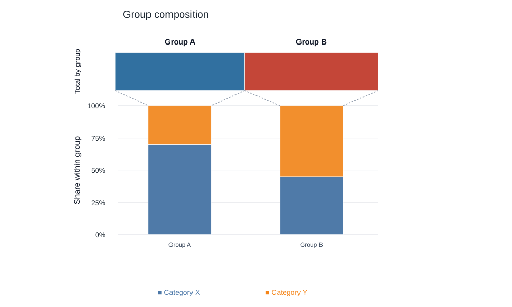

# Plotly Temple Plot

Composition plots that connect class totals with normalized segment shares.
Use them to show both how much each group contributes and how its composition
differs from the others.



## Install

Requires Python 3.10 or newer.

```bash
python -m pip install "git+https://github.com/mmmddd98/plotly-temple-plot.git"
```

## Quick start

```python
from temple_plot import TemplePlot

classes = [
    {"name": "Group A", "fractions": [
        {"name": "Batch 1", "segments": {"Category X": 42, "Category Y": 18}},
    ]},
    {"name": "Group B", "fractions": [
        {"name": "Batch 1", "segments": {"Category X": 28, "Category Y": 34}},
    ]},
]
fig = TemplePlot(classes, title="Group composition").create_figure()
fig.show()
```

Each class contains named fractions with numeric segment values. By default,
fractions are aggregated per class. Set `aggregate_classes=False` to show them
separately, or `orientation="portrait"` to change the layout.

## Examples and options

- [Data model, colors and layout options](docs/usage.md)
- [Animated demonstration](examples/demo-clip.gif)
- [Plotly example](examples/basic.py), [Dash app](examples/dash_app.py) and
  [notebook gallery](examples/show.ipynb)

Run examples from a source checkout after `python -m pip install -e .`:

```bash
python examples/basic.py
python examples/dash_app.py
```

## Development

```bash
python -m unittest discover -s tests -v
```

The preview uses the quick-start data. Regenerate it with
`python docs/generate_preview.py` after installing `kaleido` and a compatible
Chrome/Chromium browser.
