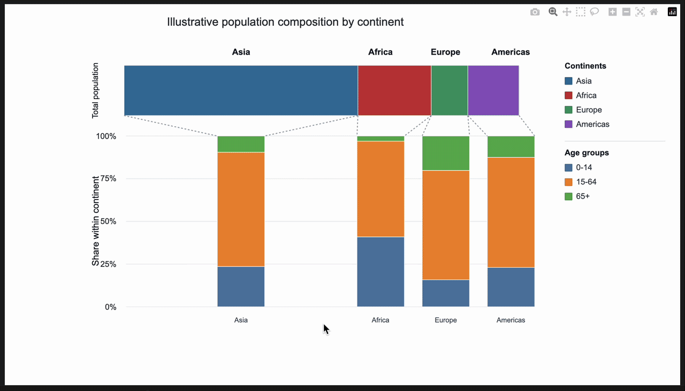

# Plotly Temple Plot

A small Plotly component for Temple-style fraction composition plots. It shows
how a set of top-level classes contributes to a total and how each class is
split into normalized composition segments.

<p align="center">
    
</p>

## Why Use It?

- Compare 2-4 master classes in one continuous proportional bar.
- Show one normalized stacked composition bar per class.
- Switch to per-fraction bars with `aggregate_classes=False`.
- Use landscape or portrait orientation.
- Hover over fields to inspect raw and normalized values.
- Embed the figure in notebooks, static HTML, or Dash apps.
- Toggle master classes and composition segments with the custom split legend.

## Install

For local development:

```bash
pip install -e .
```

Directly from GitHub:

```bash
pip install git+https://github.com/mmmddd98/plotly-temple-plot.git
```

## Quick Start

```python
from temple_plot import TemplePlot

classes = [
    {
        "name": "Discovery",
        "color": "#2F6F9F",
        "fractions": [
            {
                "name": "batch_A",
                "segments": {
                    "high confidence": 42,
                    "shared": 18,
                    "low evidence": 7,
                },
            },
            {
                "name": "batch_B",
                "segments": {
                    "high confidence": 31,
                    "shared": 25,
                    "low evidence": 11,
                },
            },
        ],
    },
    {
        "name": "Validation",
        "color": "#C44536",
        "fractions": [
            {
                "name": "batch_A",
                "segments": {
                    "high confidence": 28,
                    "shared": 34,
                    "low evidence": 8,
                },
            },
        ],
    },
]

fig = TemplePlot(
    classes,
    title="Temple composition",
    orientation="landscape",
    aggregate_classes=True,
).create_figure()

fig.show()
```

## Interactive Examples

Run the minimal Plotly example:

```bash
python examples/basic.py
```

Open the notebook demo:

```bash
jupyter notebook examples/show.ipynb
```

The notebook includes a small gallery of illustrative synthetic datasets for
choosing a README or GIF example.

Run the Dash demo:

```bash
python examples/dash_app.py
```

The notebook and Dash examples render the custom HTML wrapper with hover
tooltips and an interactive split legend for master classes and composition
segments.

## Data Model

`TemplePlot` expects a list of class dictionaries. Each class has a `name`,
an optional `color`, and one or more `fractions`. Each fraction contains named
numeric `segments`.

```python
[
    {
        "name": "specific",
        "color": "#EF553B",
        "fractions": [
            {
                "name": "baseline",
                "segments": {
                    "dimethyl": 55,
                    "free": 175,
                    "acetyl": 50,
                },
            }
        ],
    }
]
```

Segment colors can be provided per fraction:

```python
{
    "name": "baseline",
    "segments": {"dimethyl": 55, "free": 175, "acetyl": 50},
    "segment_colors": {
        "dimethyl": "#7C3AED",
        "free": "#14B8A6",
        "acetyl": "#F59E0B",
    },
}
```

## Options

```python
TemplePlot(
    classes,
    title="Temple composition",
    orientation="landscape",     # "landscape" or "portrait"
    aggregate_classes=True,      # False keeps one bar per fraction
    composition_gridlines=True,  # faint 0/25/50/75/100% guide lines
    min_bar_gap=0.18,            # minimum gap between composition bars
    master_legend_title="Groups",
    composition_legend_title="Segments",
    composition_axis_title="Share within group",
    master_axis_title="Total by group",
    width=900,
    height=520,
)
```

## Development

Run the tests:

```bash
python -m unittest
```

The package is intentionally lightweight and currently depends on Plotly,
NumPy, and Dash for the example app.
